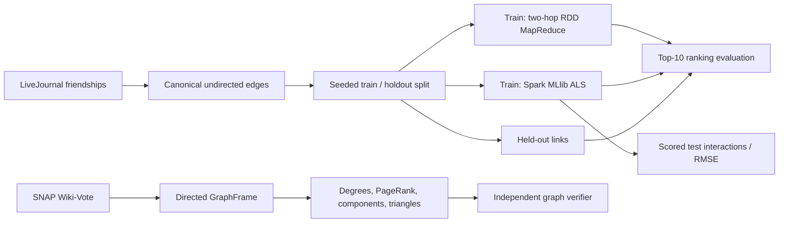
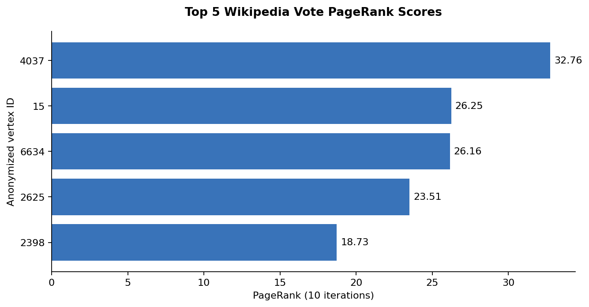
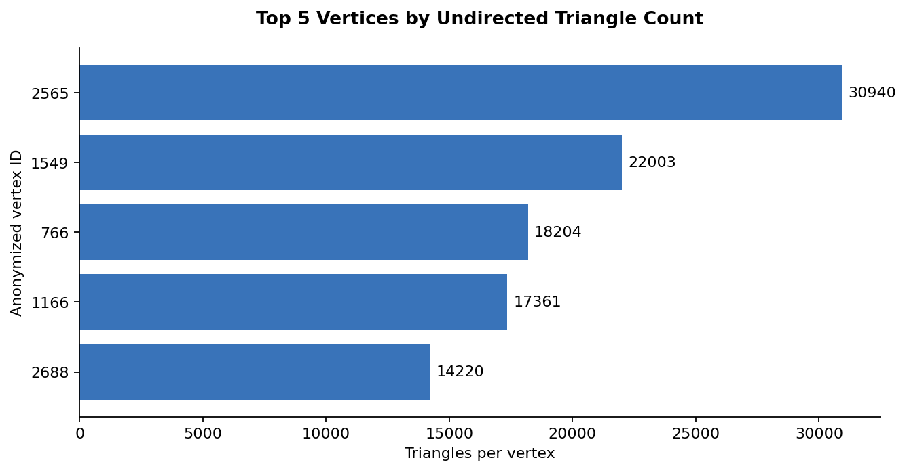

# Distributed Graph Analytics & Recommendation Engine

Social platforms use graph data to suggest new connections, and moderation teams use it to understand participation and influence. This project implements both workflows with **Python, PySpark, Spark MLlib, and GraphFrames**. It benchmarks mutual-friend MapReduce against alternating least squares (ALS) on LiveJournal and analyzes Wikipedia administrator votes with a separate directed-graph pipeline.

## Architecture



MapReduce joins two hops over training edges and aggregates one vote per shared friend with `reduceByKey`. ALS fits nonnegative latent factors to observed friendships and sampled nonedges. Both ranking methods exclude self-links and training friends and break score ties by ascending user ID. Wiki-Vote uses directed degrees and PageRank, weak connectivity, and undirected triangle topology. See the [architecture notes](docs/architecture.md).

## Datasets

| Input | Semantics | How to obtain it |
| --- | --- | --- |
| LiveJournal benchmark | Undirected adjacency list, one user per row | Download `soc-LiveJournal1Adj.txt` from the [benchmark input source](https://an-ml.s3.us-west-1.amazonaws.com/soc-LiveJournal1Adj.txt) and place it in `data/`. Check its SHA-256 against the [benchmark record](results/livejournal_recommendations.json). |
| SNAP Wiki-Vote | Directed voter-to-candidate edges | Run the SNAP downloader below. [Dataset and published statistics](https://snap.stanford.edu/data/wiki-Vote.html) |
| LiveJournal smoke-test fixture | Small synthetic adjacency list | Included at `data/sample_livejournal_adj.txt`. |

Stanford SNAP also distributes a [separate directed LiveJournal network](https://snap.stanford.edu/data/soc-LiveJournal1.html). The [dataset guide](data/README.md) explains how to convert it into a distinct experimental input.

## Run locally

From the repository root, use Docker Engine with Compose v2 and network access for dependency and dataset downloads. The image pins Python 3.11, Java 17, PySpark 3.5.5, and the GraphFrames Python package. Allow several gigabytes of memory for local Spark.

```bash
docker compose build spark
docker compose run --rm spark python -m pytest -q tests
```

### Friend recommendations

Run the included synthetic fixture to exercise both algorithms.

```bash
docker compose run --rm spark spark-submit --master 'local[2]' --driver-memory 2g scripts/run_recommendations.py --input data/sample_livejournal_adj.txt --method both --output metrics/sample_recommendations.json
```

For the real graph, place the verified input in `data/` and run the same evaluation protocol with seed 42.

```bash
docker compose run --rm spark spark-submit --master 'local[4]' --driver-memory 4g scripts/run_recommendations.py --input data/soc-LiveJournal1Adj.txt --method both --users 10 --top-k 10 --seed 42 --test-fraction 0.2 --negative-pool 20000 --shuffle-partitions 8 --output metrics/recommendations.json
```

This Docker command uses the same protocol as the archived benchmark. The [benchmark notes](docs/results.md) record the exact native Windows configuration and explain which results may vary across Spark versions or partition layouts.

### Wikipedia graph analytics

```bash
docker compose run --rm spark python scripts/download_wiki_vote.py
docker compose run --rm spark spark-submit --master 'local[2]' --driver-memory 3g --packages io.graphframes:graphframes-spark3_2.12:0.12.3 scripts/run_graph_analytics.py
docker compose run --rm spark python scripts/verify_graph.py --input data/wiki-Vote.txt.gz --results metrics/wiki_vote_graph.json --verification-output metrics/wiki_vote_verification.json --expect-wiki-vote
```

The verifier can also check the [archived GraphFrames output](results/archived_wikivote_results.json). With the downloaded dataset and Python available, run it without Spark.

```bash
python scripts/verify_graph.py --input data/wiki-Vote.txt.gz --results results/archived_wikivote_results.json --verification-output metrics/wiki_vote_verification.json --expect-wiki-vote
```

## Verified results

### LiveJournal link recovery

The November 2026 benchmark processed **49,995 users** and **330,798 unique undirected friendships**. A seeded split with 80/20 weights produced **264,583 training edges** and **66,215 test edges** with zero overlap. The ranking metrics cover **10 sampled users** with a combined 26 held-out user–friend entries.

| Method | Precision@10 | Recall@10 | Hit Rate@10 | Test RMSE | Wall time |
| --- | ---: | ---: | ---: | ---: | ---: |
| Mutual-friend MapReduce | 6% | 23% | 30% | — | 91.674 s |
| Spark MLlib ALS | 0% | 0% | 0% | 0.301713 | 111.534 s |

**End-to-end wall time was 305.882 seconds**, including Spark startup and preprocessing. MapReduce recovered six links across three users. ALS returned recommendations for all ten users and recovered zero links in their top ten. Its RMSE covers **261,074 of 264,531** held-out binary interactions after dropping cold-start rows. The [audited JSON](results/livejournal_recommendations.json) preserves the split counts, rankings, interaction counts, input digest, and runtime environment.

### Wikipedia voting network

The archived GraphFrames run processed **7,115 vertices** and **103,689 directed edges**. It found **608,389 undirected triangles** and 24 weakly connected components, with 7,066 vertices in the largest component. The leading PageRank vertex was ID 4037 at 32.7614. Vertex 2565 belonged to 30,940 triangles. See the [original output](results/archived_wikivote_results.json) and [verification record](results/archived_wikivote_verification.json).

| Top PageRank scores | Top triangle counts |
| --- | --- |
|  |  |

Regenerate both figures from the archived output with `docker compose run --rm spark python scripts/plot_results.py`.

## Evaluation and limitations

The split happens before reciprocal friendships become directed ALS interactions. The evaluation averages per-user precision and recall and counts the fraction of users with a hit. ALS uses a separate test set of positive edges and sampled nonedges, screens both negative pools against all known friendships, and removes training negatives from the test pool. The [evaluation guide](docs/evaluation.md) defines the metrics and their timing windows.

The ranking sample is small and includes only users with a withheld friendship. Results describe offline link recovery for those users. ALS RMSE depends on the negative-sampling protocol and scored-row coverage. High-degree users can make two-hop expansion expensive, and ALS scores the evaluation users against the vertex set. Follow-up experiments could evaluate a larger degree-stratified sample across several seeds, compare implicit-feedback ALS against the mutual-friend baseline, and benchmark candidate retrieval at larger scales.

## Repository guide

| Path | Contents |
| --- | --- |
| `src/graphrec/` | Input normalization, ranking metrics, MapReduce, ALS, and GraphFrames analytics |
| `scripts/` | Spark entry points, dataset utilities, plotting, and verification |
| `tests/` | Parser, ranking, and graph-verifier unit tests |
| `docs/` | Architecture, evaluation, provenance, and figures |
| `results/` | Reviewed benchmark snapshots and verification records |
